# 🚀 Python Foundations Journey

**A 30-day intensive learning journey to build the foundations for a career in AI Engineering through hands-on coding, problem-solving, data analysis, and practical projects.**

## 🎯 About This Repository

This repository documents my journey from learning Python fundamentals to building a foundation in data analysis and preparing for Machine Learning and AI Engineering.

My goal is to develop strong programming fundamentals, learn to work with real-world datasets, solve problems independently, and build a portfolio of practical projects.

Rather than focusing only on watching tutorials, I prioritize **hands-on coding, consistent practice, debugging, project building, and documenting what I learn.**

## 🗺️ Learning Roadmap

| Day    | Main Focus                  | Repo                                                                                                                                       			 | Output                       |
| ------ | --------------------------- | --------------------------------------------------------------------------------------------------------------------------------------------------------| ---------------------------- |
| **1**  | CS50P Functions + Variables | [day01_python_foundations](https://github.com/chinmayeeph/180_Days_AI_Engineer_Journey/tree/main/01_Python/day01_python_foundations)                    | 10+ tiny programs            |
| **2**  | CS50P Conditionals          | [day02_conditions](https://github.com/chinmayeeph/180_Days_AI_Engineer_Journey/tree/main/01_Python/day02_conditions)                                    | Conditional exercises        |
| **3**  | CS50P Loops                 | [day03_loops](https://github.com/chinmayeeph/180_Days_AI_Engineer_Journey/tree/main/01_Python/day03_loops)                                              | Loop problem set             |
| **4**  | CS50P Exceptions            | [day04_exceptions](https://github.com/chinmayeeph/180_Days_AI_Engineer_Journey/tree/main/01_Python/day04_exceptions)                                    | Error-handling programs      |
| **5**  | CS50P Libraries             | [day05_libraries_modules_packages](https://github.com/chinmayeeph/180_Days_AI_Engineer_Journey/tree/main/01_Python/day05_libraries_modules_packages)    | Library-based programs       |
| **6**  | CS50P Unit Tests            | [day01_python_foundations](https://github.com/chinmayeeph/180_Days_AI_Engineer_Journey/tree/main/01_Python/day01_python_foundations)                    | Test your programs           |
| **7**  | CS50P File I/O              | [day01_python_foundations](https://github.com/chinmayeeph/180_Days_AI_Engineer_Journey/tree/main/01_Python/day01_python_foundations)                    | File-processing mini project |
| **8**  | CS50P Regular Expressions   | [day01_python_foundations](https://github.com/chinmayeeph/180_Days_AI_Engineer_Journey/tree/main/01_Python/day01_python_foundations)                    | Text-processing project      |
| **9**  | CS50P OOP / Classes         | [day01_python_foundations](https://github.com/chinmayeeph/180_Days_AI_Engineer_Journey/tree/main/01_Python/day01_python_foundations)                    | OOP exercises                |
| **10** | Python consolidation        | [day01_python_foundations](https://github.com/chinmayeeph/180_Days_AI_Engineer_Journey/tree/main/01_Python/day01_python_foundations)                    | Python mini project #1       |
| **11** | Python advanced practice    | [day01_python_foundations](https://github.com/chinmayeeph/180_Days_AI_Engineer_Journey/tree/main/01_Python/day01_python_foundations)                    | Python mini project #2       |
| **12** | Python capstone             | [day01_python_foundations](https://github.com/chinmayeeph/180_Days_AI_Engineer_Journey/tree/main/01_Python/day01_python_foundations)                    | Complete Python project      |

*The roadmap is a learning target. Actual progress may vary depending on practice, debugging, and project complexity.*

## 🛠️ Tools and Technologies

The tools I plan to use throughout this journey include:

- **Programming:** Python
- **Development:** Visual Studio Code, Jupyter Notebook, Google Colab
- **Numerical Computing:** NumPy
- **Data Analysis:** Pandas
- **Data Visualization:** Matplotlib, Seaborn
- **Databases:** SQL, SQLite
- **Version Control:** Git and GitHub
- **Datasets and Practice:** Kaggle

## 💻 Project-Based Learning

I aim to reinforce each concept by applying it to practical exercises and projects.

Planned project ideas include:

- Personal Expense Analyzer
- Student Performance Analyzer
- Sales Data Analysis Dashboard
- NumPy Student Marks Analysis
- Data Cleaning and Transformation Project
- Exploratory Data Analysis Project
- Kaggle Dataset Analysis
- End-to-End Data Analysis Capstone

Project names and scope may evolve as I develop my skills and identify more interesting datasets.

## 🏆 Kaggle Practice

Kaggle will be part of my practical learning process.

My goals are to:

- Work with real-world datasets.
- Practise data cleaning and preprocessing.
- Perform exploratory data analysis.
- Create meaningful visualizations.
- Document findings and analytical insights.
- Learn from public notebooks and community discussions.
- Build a consistent portfolio of data projects.

**Planned beginner competition:** Titanic — Machine Learning from Disaster.

Kaggle competition participation and results will be documented as I complete them.

## 📂 Repository Structure

The repository will be organized by learning day so that exercises, projects, and notes remain easy to find.

```text
Foundations-Journey/
│
├── README.md
│
├── 01_Python
│	├── Day-01-Python_Foundations/
│	├── Day-02-Conditionals/
│	├── Day-03-Loops/
│	├── Day-04-Exceptions/
│	├── Day-05-Libraries-Modules-Packages/
│	├── Day-06-Unit-Testing/
│	├── Day-07-File-Handling/
│	├── Day-08-Regular-Expressions/
│	├── Day-09-OOP-Classes/
│	├── Day-10-Python-Mini-Project/
│	├── Day-11-Python-Practice/
│	└── Day-12-Python-Capstone/
│
├── 03_Numpy
│	├── Day-13-NumPy-Fundamentals/
│	├── Day-14-NumPy-Operations/
│	└── Day-15-NumPy-Project/
│
├── 04_Pandas
│	├── Day-16-Pandas-Fundamentals/
│	├── Day-17-Pandas-Data-Cleaning/
│	├── Day-18-Pandas-GroupBy/
│	├── Day-19-Pandas-Merge-Dates/
│	└── Day-20-Pandas-Project/
│
├── 05_EDA
│	├── Day-21-Matplotlib/
│	├── Day-22-Seaborn/
│	└── Day-23-Data-Visualization-Project/
│	├── Day-24-EDA/
│	└── Day-25-Kaggle-EDA-Project/
│
└── 06_SQL
	├── Day-26-SQL-Fundamentals/
	├── Day-27-SQL-Intermediate/
	└── Day-28-SQL-Python/
	├── Day-29-End-to-End-Project/
	└── Day-30-Independent-Capstone/
```

*This is the planned organization; folder names can be adjusted to match the actual repository as the work progresses.* 

You can view the rest 18 days in [Numpy,](https://github.com/chinmayeeph/180_Days_AI_Engineer_Journey/tree/main/03_NumPy)  [Pandas,](https://github.com/chinmayeeph/180_Days_AI_Engineer_Journey/tree/main/04_Pandas) [EDA,](https://github.com/chinmayeeph/180_Days_AI_Engineer_Journey/tree/main/05_EDA) [SQL](https://github.com/chinmayeeph/180_Days_AI_Engineer_Journey/tree/main/06_SQL)

## 📈 My Learning Approach

My daily learning strategy emphasizes practice over passive consumption.

- **30% Learning:** Lectures, documentation, reading, and concept revision.
- **70% Coding:** Exercises, independent problem-solving, debugging, and projects.

My learning principles:

1. Write code myself instead of blindly copying solutions.
2. Understand the purpose of every function, condition, and loop.
3. Break complex problems into smaller steps.
4. Debug errors and document what I learn from them.
5. Practise consistently and revisit difficult concepts.
6. Push meaningful progress to GitHub.
7. Build projects that demonstrate understanding, not just course completion.

# 📌 30-DAY PROGRESSION

Here's the whole thing visually:
graph TD
    %% Styling Configuration
    classDef default fill:#1f2937,stroke:#4b5563,stroke-width:2px,color:#f3f4f6,font-family:sans-serif;
    classDef highlight fill:#2563eb,stroke:#3b82f6,stroke-width:2px,color:#ffffff,font-weight:bold;

```mermaid
flowchart TD
    %% Custom Interactive Themes & Color Grading
    classDef tracking fill:#0f172a,stroke:#38bdf8,stroke-width:2px,color:#38bdf8,font-family:monospace;
    classDef coreCode fill:#1e1b4b,stroke:#818cf8,stroke-width:2px,color:#e0e7ff,font-size:13px;
    classDef dataPrep fill:#064e3b,stroke:#34d399,stroke-width:2px,color:#d1fae5,font-size:13px;
    classDef analytics fill:#7c2d12,stroke:#fb923c,stroke-width:2px,color:#ffedd5,font-size:13px;
    classDef launch fill:#4c1d95,stroke:#c084fc,stroke-width:3px,color:#f3e8ff,font-weight:bold,font-size:14px;

    %% ----------------------------------------------------
    %% PHASE LEVEL LABELS (Visual Group Anchors)
    %% ----------------------------------------------------
    START([⚡ STARTING LINE]):::tracking
    
    subgraph PHASE_1 ["💻 FOUNDATIONAL PYTHON ENGINE"]
        Py["🐍 CS50P PYTHON CORE <br> ───<br>• Syntax & Structural Control <br>• File Operations & OOP Logic<br>📂 <b>Days 1–12</b>"]:::coreCode
    end

    subgraph PHASE_2 ["🔢 DATA MANIPULATION PIPELINE"]
        Np["🔢 NUMPY MATRIX OPERATIONS<br>───<br>• Multi-Dim Vectors & Arrays<br>• High-Speed Mathematical Vectorization<br>📂 <b>Days 13–15</b>"]:::dataPrep
        Pd["🐼 PANDAS DATA WRANGLING<br>───<br>• Advanced DataFrame Transformations<br>• Data Cleansing & Aggregate Pipelines<br>📂 <b>Days 16–20</b>"]:::dataPrep
    end

    subgraph PHASE_3 ["🎨 ADVANCED STATISTICAL VISUALIZATION"]
        Mpl["📊 MATPLOTLIB CANVAS<br>───<br>• Plot Architectures & Configurations<br>📂 <b>Day 21</b>"]:::analytics
        Sbn["📈 SEABORN MODELING VIA PLOTS<br>───<br>• Complex Correlative Dist Heatmaps<br>📂 <b>Day 22</b>"]:::analytics
        Vis["🖼️ REFINING THE METRICS CANVAS<br>───<br>• Visual Storytelling & Insights Design<br>📂 <b>Day 23</b>"]:::analytics
    end

    subgraph PHASE_4 ["🔎 METRIC CAPTURE & REPOSITORIES"]
        Eda["🔎 EXPLORATORY DATA ANALYSIS<br>───<br>• Statistical Discovery & Outlier Control<br>📂 <b>Day 24</b>"]:::analytics
        KagEda["🎯 KAGGLE PIPELINE COMPETITION<br>───<br>• Reverse Engineering Feature Matrices<br>📂 <b>Day 25</b>"]:::analytics
        Sql["🗄️ STRUCTURED QUERY LANGUAGE (SQL)<br>───<br>• Deep Join Operations & Database Relational Queries<br>📂 <b>Days 26–28</b>"]:::coreCode
    end

    subgraph PHASE_5 ["🚀 THE CAPSTONE RAMP"]
        KagProj["🛸 FINISHING THE KAGGLE PIPELINE<br>───<br>• End-to-End Prediction Processing Model<br>📂 <b>Day 29</b>"]:::launch
        Final(["🏆 MONUMENTAL CAPSTONE DEPLOYMENT<br>───<br>• Deep Architectural Engineering Setup Complete<br>🏁 <b>Day 30</b>"]):::launch
    end

    %% ----------------------------------------------------
    %% HIGH INTERACT TRANSITION PATHWAYS
    %% ----------------------------------------------------
    START ==> Py
    Py ==> Np
    Np --> Pd
    Pd ==> Mpl
    Mpl --> Sbn --> Vis
    Vis ==> Eda
    Eda --> KagEda --> Sql
    Sql ==> KagProj
    KagProj ==> Final
```



## ✅ Progress Tracker

- [ ] Complete Python fundamentals.
- [ ] Practise functions, conditionals, and loops.
- [ ] Learn modules, packages, and exception handling.
- [ ] Complete Python mini-projects.
- [ ] Learn NumPy.
- [ ] Learn Pandas and data cleaning.
- [ ] Learn Matplotlib and Seaborn.
- [ ] Complete exploratory data analysis.
- [ ] Practise SQL queries.
- [ ] Complete a Kaggle notebook.
- [ ] Build an end-to-end data analysis project.
- [ ] Complete an independent capstone.
- [ ] Document projects and learning outcomes.

## 🚀 What's Next?

This 30-day journey is the first stage of my broader six-month AI Engineer roadmap. 

After establishing these foundations, my planned progression is:

**Python & Data Analysis → Machine Learning → Deep Learning & NLP → LLM Engineering & RAG → AI Agents & Backend → Production AI & MLOps**

The long-term goal is to develop the skills required to build, evaluate, deploy, and maintain practical AI applications.

## 🌱 Learning in Public

This repository represents my commitment to continuous learning, disciplined practice, and building in public.

I am documenting the process—not just the finished projects—including mistakes, debugging experiences, lessons learned, and improvements.

Every commit represents another step toward becoming an AI Engineer.

**One day at a time. One concept at a time. One project at a time.** 💻🚀

---

*Built with Python, curiosity, consistency, and a commitment to lifelong learning.*
