# 🚀 180 Days AI Engineer Journey

**My 180-day journey from Python fundamentals to building practical Machine Learning, Deep Learning, and Generative AI applications.**

## 🎯 About This Repository

Welcome to my **180 Days AI Engineer Journey**!

This repository documents my learning journey as I work toward becoming an AI Engineer through structured learning, hands-on coding, problem-solving, and practical projects.

Coming from an Aeronautical Engineering background, I am building my software development and AI skills step by step. My focus is on understanding fundamental concepts, writing code independently, learning from mistakes, and developing projects that demonstrate practical skills.

Rather than only watching tutorials, I aim to follow a **learning-by-doing approach**, with consistent coding practice, debugging, revision, and project development.

## 🗺️ My AI Engineering Roadmap

My learning journey is organized into the following stages:

| Folder | Learning Stage | Main Topics |
|---|---|---|
| [01_Python](https://github.com/chinmayeeph/180_Days_AI_Engineer_Journey/tree/main/01_Python) | Python Fundamentals | Variables, data types, conditionals, loops, functions, exceptions, modules, file handling, and OOP |
| [02_DSA](https://github.com/chinmayeeph/180_Days_AI_Engineer_Journey/tree/main/02_DSA) | Data Structures & Algorithms | Problem-solving, complexity basics, arrays, strings, searching, sorting, and common data structures |
| [03_NumPy](https://github.com/chinmayeeph/180_Days_AI_Engineer_Journey/tree/main/03_NumPy) | Numerical Computing | Arrays, indexing, slicing, vectorization, broadcasting, and mathematical operations |
| [04_Pandas](https://github.com/chinmayeeph/180_Days_AI_Engineer_Journey/tree/main/04_Pandas) | Data Manipulation | Series, DataFrames, filtering, grouping, merging, missing values, and data cleaning |
| [05_EDA](https://github.com/chinmayeeph/180_Days_AI_Engineer_Journey/tree/main/05_EDA) | Exploratory Data Analysis | Data exploration, descriptive statistics, patterns, correlations, and visual insights |
| [06_SQL](https://github.com/chinmayeeph/180_Days_AI_Engineer_Journey/tree/main/06_SQL) | Database Fundamentals | Queries, filtering, aggregation, joins, subqueries, and analytical SQL |
| [07_ML](https://github.com/chinmayeeph/180_Days_AI_Engineer_Journey/tree/main/07_ML) | Machine Learning | Data preprocessing, feature engineering, supervised and unsupervised learning, and model evaluation |
| [08_Deep_Learning](https://github.com/chinmayeeph/180_Days_AI_Engineer_Journey/tree/main/08_Deep_Learning) | Deep Learning | Neural networks, training, backpropagation, deep learning architectures, and model development |
| [09_GenAI](https://github.com/chinmayeeph/180_Days_AI_Engineer_Journey/tree/main/09_GenAI) | Generative AI | LLMs, prompting, embeddings, Transformers, RAG, and AI application development |
| [10_Projects](https://github.com/chinmayeeph/180_Days_AI_Engineer_Journey/tree/main/10_Projects) | Practical Implementation | Applying learned concepts through independent, end-to-end projects |
| [11_Production_AI_MLOps](https://github.com/chinmayeeph/180_Days_AI_Engineer_Journey/tree/main/11_Production_AI_MLOps) | Production ready works | FastAPI, Docker, Cloud Fundamentals, Deployment, CI CD GitHub Actions, MLflow_Experiment, Security Secrets Cost Optimization, AI System Design |

*This roadmap represents my planned learning structure. Topics and project scope may evolve as I progress.*

## 🛠️ Tools and Technologies

The tools and technologies I plan to explore throughout this journey include:

- **Programming:** Python
- **Development:** VS Code, Jupyter Notebook, Google Colab
- **Version Control:** Git and GitHub
- **Numerical Computing:** NumPy
- **Data Analysis:** Pandas
- **Data Visualization:** Matplotlib and Seaborn
- **Databases:** SQL and SQLite
- **Machine Learning:** Scikit-learn
- **Deep Learning:** PyTorch and other relevant frameworks
- **Generative AI:** Large Language Models, embeddings, vector databases, and RAG frameworks
- **Practice and Datasets:** Kaggle

*Tools will be added to this list as I learn and use them in my projects.*

## 💻 Project-Based Learning

Projects are an essential part of this journey. My goal is to move beyond isolated exercises and learn how to solve practical problems using code and data.

My project work will progressively cover:

- Python automation and programming projects
- Data structures and algorithmic problem-solving
- NumPy numerical analysis
- Pandas data cleaning and transformation
- Exploratory data analysis and visualization
- SQL-based data analysis
- Machine Learning models
- Deep Learning experiments
- Generative AI applications
- LLM-powered applications using Retrieval-Augmented Generation (RAG)
- End-to-end AI projects

Each project will be documented with its objective, implementation, tools, key learnings, and instructions for running it whenever applicable.

## 📂 Repository Structure

The repository is organized into learning stages, making it easier to track progress and find exercises, notes, and projects.

```text
# 180_Days_AI_Engineer_Journey --- Complete Folder Structure

│   This structure follows the six-month AI Engineer roadmap:
│
│   Month 1: Python + Data Foundations
│   Month 2: Machine Learning Foundations
│   Month 3: Deep Learning + NLP
│   Month 4: LLM Engineering + RAG
│   Month 5: AI Agents + Backend + Cloud
│   Month 6: Production AI + MLOps + Job Preparation
│
│   The original ten top-level folders are retained.
│   `11_Production_AI_MLOps` is added to give production deployment, monitoring, testing, and CI/CD a dedicated home.
│
├── README.md
├── LICENSE
├── .gitignore
│
├── 01_Python/
│   ├── README.md
│   ├── Day-01-Variables-Functions/
│   ├── Day-02-Conditionals/
│   ├── Day-03-Loops/
│   ├── Day-04-Exceptions/
│   ├── Day-05-Libraries-Modules-Packages/
│   ├── Day-06-Unit-Testing/
│   ├── Day-07-File-Handling/
│   ├── Day-08-Regular-Expressions/
│   ├── Day-09-OOP-Classes/
│   ├── Day-10-Python-Mini-Project/
│   ├── Day-11-Python-Practice/
│   ├── Day-12-Python-Capstone/
│   ├── Day-13-NumPy-Fundamentals/
│   ├── Day-14-NumPy-Operations/
│   ├── Day-15-NumPy-Project/
│   ├── Day-16-Pandas-Fundamentals/
│   ├── Day-17-Pandas-Data-Cleaning/
│   ├── Day-18-Pandas-GroupBy/
│   ├── Day-19-Pandas-Merge-Dates/
│   ├── Day-20-Pandas-Project/
│   ├── Day-21-Matplotlib/
│   ├── Day-22-Seaborn/
│   ├── Day-23-Data-Visualization-Project/
│   ├── Day-24-EDA/
│   ├── Day-25-Kaggle-EDA-Project/
│   ├── Day-26-SQL-Fundamentals/
│   ├── Day-27-SQL-Intermediate/
│   ├── Day-28-SQL-Python/
│   ├── Day-29-End-to-End-Project/
│   ├── Day-30-Independent-Capstone/
│   └── resources/
│
├── 02_DSA/
│   ├── README.md
│   ├── 01_Complexity_Basics/
│   ├── 02_Arrays_Strings/
│   ├── 03_Hashing_Dictionaries_Sets/
│   ├── 04_Two_Pointers_Sliding_Window/
│   ├── 05_Stacks_Queues/
│   ├── 06_Linked_Lists/
│   ├── 07_Recursion_Backtracking/
│   ├── 08_Searching_Sorting_Binary_Search/
│   ├── 09_Trees_Heaps/
│   ├── 10_Graphs/
│   ├── 11_Greedy_Dynamic_Programming/
│   ├── 12_Interview_Problems/
│   └── resources/
│
├── 03_NumPy/
│   ├── README.md
│   ├── 01_Array_Fundamentals/
│   ├── 02_Indexing_Slicing_Reshaping/
│   ├── 03_DataTypes_Vectorization/
│   ├── 04_Broadcasting/
│   ├── 05_Mathematical_Operations/
│   ├── 06_Statistical_Operations/
│   ├── 07_Random_Numbers/
│   ├── 08_Linear_Algebra_Basics/
│   ├── 09_Practice_Exercises/
│   ├── 10_Notebooks/
│   └── projects/
│       └── student_marks_analysis/
│
├── 04_Pandas/
│   ├── README.md
│   ├── 01_Series_DataFrames/
│   ├── 02_Loading_Inspecting_Data/
│   ├── 03_Indexing_Filtering_Sorting/
│   ├── 04_Missing_Data_Duplicates/
│   ├── 05_DataTypes_String_DateTime/
│   ├── 06_GroupBy_Aggregation/
│   ├── 07_Merge_Join_Concat/
│   ├── 08_Pivot_Tables/
│   ├── 09_Data_Cleaning_Transformation/
│   ├── 10_Practice_Notebooks/
│   └── projects/
│       ├── student_performance_analyzer/
│       └── sales_data_analysis/
│
├── 05_EDA/
│   ├── README.md
│   ├── 01_EDA_Workflow/
│   ├── 02_Data_Quality_Assessment/
│   ├── 03_Descriptive_Statistics/
│   ├── 04_Univariate_Analysis/
│   ├── 05_Bivariate_Multivariate_Analysis/
│   ├── 06_Outliers_Distributions_Correlation/
│   ├── 07_Matplotlib/
│   ├── 08_Seaborn/
│   ├── 09_Insight_Generation_Storytelling/
│   ├── datasets/
│   ├── notebooks/
│   └── projects/
│       ├── titanic_survival_analysis/
│       ├── sales_data_eda/
│       └── customer_data_eda/
│
├── 06_SQL/
│   ├── README.md
│   ├── 01_SQL_Fundamentals/
│   ├── 02_SELECT_WHERE_ORDER_BY/
│   ├── 03_Aggregations_GROUP_BY_HAVING/
│   ├── 04_JOINS/
│   ├── 05_Subqueries_CTEs/
│   ├── 06_Window_Functions/
│   ├── 07_CASE_Date_String_Functions/
│   ├── 08_Data_Definition_Manipulation/
│   ├── 09_SQL_Exercises/
│   ├── 10_Python_SQL_Integration/
│   └── projects/
│
├── 07_ML/
│   ├── README.md
│   ├── 01_Statistics_Probability/
│   ├── 02_ML_Fundamentals/
│   ├── 03_Data_Preprocessing/
│   ├── 04_Feature_Engineering/
│   ├── 05_Train_Validation_Test_Splits/
│   ├── 06_Supervised_Learning/
│   │   ├── regression/
│   │   └── classification/
│   ├── 07_Unsupervised_Learning/
│   │   ├── clustering/
│   │   └── dimensionality_reduction/
│   ├── 08_Model_Evaluation/
│   ├── 09_Cross_Validation/
│   ├── 10_Hyperparameter_Tuning/
│   ├── 11_Scikit_Learn_Pipelines/
│   ├── 12_Imbalanced_Data/
│   ├── 13_Model_Explainability/
│   ├── 14_Model_Saving_Inference/
│   ├── 15_Exercises/
│   ├── notebooks/
│   └── projects/
│       ├── house_price_prediction/
│       ├── customer_churn_prediction/
│       └── customer_segmentation/
│
├── 08_Deep_Learning/
│   ├── README.md
│   ├── 01_Deep_Learning_Fundamentals/
│   ├── 02_Tensors_Linear_Algebra/
│   ├── 03_Neural_Networks/
│   ├── 04_Forward_Propagation_Backpropagation/
│   ├── 05_Loss_Optimization_Regularization/
│   ├── 06_PyTorch_Fundamentals/
│   ├── 07_Datasets_DataLoaders/
│   ├── 08_Model_Training_Validation/
│   ├── 09_CNNs_Computer_Vision/
│   ├── 10_RNN_LSTM_Sequence_Models/
│   ├── 11_NLP_Fundamentals/
│   ├── 12_Tokenization_Embeddings/
│   ├── 13_Attention_Transformers/
│   ├── 14_Hugging_Face/
│   ├── 15_Transfer_Learning/
│   ├── 16_Exercises/
│   ├── notebooks/
│   └── projects/
│       ├── image_classification/
│       ├── sentiment_analysis/
│       └── transformer_text_classifier/
│
├── 09_GenAI/
│   ├── README.md
│   ├── 01_LLM_Fundamentals/
│   ├── 02_Prompt_Engineering/
│   ├── 03_LLM_APIs_Local_Models/
│   ├── 04_Tokenization_Embeddings/
│   ├── 05_Vector_Databases/
│   ├── 06_Document_Loading_Chunking/
│   ├── 07_Retrieval_Augmented_Generation/
│   ├── 08_Retrieval_Reranking/
│   ├── 09_RAG_Evaluation/
│   ├── 10_Hugging_Face/
│   ├── 11_LangChain_LlamaIndex/
│   ├── 12_Fine_Tuning_Basics/
│   ├── 13_Tool_Calling/
│   ├── 14_AI_Agents/
│   ├── 15_Workflows_Memory_State/
│   ├── 16_Agent_Evaluation_Safety/
│   ├── 17_GenAI_Exercises/
│   ├── notebooks/
│   └── projects/
│   │   ├── pdf_research_assistant/
│   │   ├── document_qa_rag/
│   │   ├── multi_document_knowledge_assistant/
│   │   ├── ai_research_agent/
│   │   └── ai_data_analyst_agent/
│   └── resources/
│
├── 10_Projects/
│   ├── README.md
│   ├── 01_Python_Projects/
│   │   ├── personal_expense_analyzer/
│   │   └── student_performance_analyzer/
│   ├── 02_Data_Analysis_Projects/
│   │   └── sales_data_analysis_dashboard/
│   ├── 03_Machine_Learning_Projects/
│   │   ├── house_price_prediction/
│   │   ├── customer_churn_prediction/
│   │   └── customer_segmentation/
│   ├── 04_Deep_Learning_NLP_Projects/
│   │   ├── image_classification_system/
│   │   ├── sentiment_analysis_system/
│   │   └── transformer_text_classifier/
│   ├── 05_GenAI_RAG_Projects/
│   │   ├── pdf_research_assistant/
│   │   ├── ai_document_qa/
│   │   └── multi_document_assistant/
│   ├── 06_Agent_Projects/
│   │   ├── ai_research_agent/
│   │   └── ai_data_analyst_agent/
│   ├── 07_End_to_End_AI_Applications/
│   └── 08_Portfolio_Showcase/
│
├── 11_Production_AI_MLOps/                         
│   ├── README.md
│   ├── 01_FastAPI_Model_Serving/
│   ├── 02_Request_Validation_Error_Handling/
│   ├── 03_Testing_Pytest/
│   ├── 04_Docker_Containerization/
│   ├── 05_Databases_PostgreSQL/
│   ├── 06_Async_Programming/
│   ├── 07_Cloud_Fundamentals/
│   ├── 08_Deployment/
│   ├── 09_CI_CD_GitHub_Actions/
│   ├── 10_MLflow_Experiment_Tracking/
│   ├── 11_Model_Monitoring/
│   ├── 12_AI_Evaluation_Observability/
│   ├── 13_Security_Secrets_Cost_Optimization/
│   ├── 14_AI_System_Design/
│   ├── 15_Production_Capstone/
│   └── resources/
│
└── resources/
    ├── six_month_roadmap.md
    ├── weekly_progress_tracker.md
    ├── interview_preparation/
    │   ├── python.md
    │   ├── sql.md
    │   ├── machine_learning.md
    │   ├── deep_learning_nlp.md
    │   └── generative_ai.md
    ├── resume_linkedin_job_search.md
    └── learning_resources.md
```

*The structure above is illustrative. The actual folders and subfolders will reflect the contents I create as I progress.*

## Month-by-Month Mapping

  ---------------------------------------------------------------------------
  Month                   Main folders                Planned deliverables
  ----------------------- --------------------------- -----------------------
  1 --- Python + Data     `01_Python` to `06_SQL`     Expense analyzer,
  Foundations                                         student performance
                                                      analyzer, sales
                                                      dashboard, Titanic
                                                      analysis notebook

  2 --- Machine Learning  `07_ML`                     House price prediction,
                                                      churn prediction,
                                                      customer segmentation,
                                                      ML pipeline, Kaggle
                                                      work

  3 --- Deep Learning +   `08_Deep_Learning`          Image classification,
  NLP                                                 sentiment analysis,
                                                      Transformer text
                                                      classifier

  4 --- LLM Engineering + `09_GenAI`                  PDF research assistant,
  RAG                                                 document Q&A,
                                                      multi-document
                                                      assistant, RAG
                                                      evaluation

  5 --- AI Agents +       `09_GenAI`, `10_Projects`,  Research agent, data
  Backend + Cloud         `11_Production_AI_MLOps`    analyst agent, REST
                                                      API, Dockerized and
                                                      deployed application

  6 --- Production AI +   `10_Projects`,              Production capstone,
  MLOps + Jobs            `11_Production_AI_MLOps`,   tests, CI/CD,
                          `resources`                 monitoring, portfolio,
                                                      resume, interview
                                                      preparation
                                                      
  ---------------------------------------------------------------------------

## Structure Inside a Substantial Project

``` text
project_name/
├── README.md
├── data/
│   ├── raw/
│   └── processed/
├── notebooks/
├── src/
├── tests/
├── reports/
├── requirements.txt
├── .env.example
├── .gitignore
└── main.py
```

## AI Engineer Roadmap Visually 

```mermaid
flowchart TD
    %% Custom Interactive Themes & Color Grading
    classDef tracking fill:#0f172a,stroke:#38bdf8,stroke-width:2px,color:#38bdf8,font-family:monospace;
    classDef coreCode fill:#1e1b4b,stroke:#818cf8,stroke-width:2px,color:#e0e7ff,font-size:13px;
    classDef dataPrep fill:#064e3b,stroke:#34d399,stroke-width:2px,color:#d1fae5,font-size:13px;
    classDef modeling fill:#7c2d12,stroke:#fb923c,stroke-width:2px,color:#ffedd5,font-size:13px;
    classDef launch fill:#4c1d95,stroke:#c084fc,stroke-width:3px,color:#f3e8ff,font-weight:bold,font-size:14px;

    %% ----------------------------------------------------
    %% PHASE LEVEL LABELS & NODES
    %% ----------------------------------------------------
    START([⚡ STARTING THE 180-DAY JOURNEY]):::tracking
    
    subgraph PHASE_1 ["💻 CORE FOUNDATIONS"]
        Py["🐍 01_Python <br> (Python Fundamentals)<br>───<br>• Variables, Data Types & Control Flow<br>• Functions, Exceptions & Modules<br>• File Handling & Object-Oriented OOP"]:::coreCode
        Dsa["🧩 02_DSA <br> (Data Structures & Algorithms)<br>───<br>• Complexity Basics & Problem Solving<br>• Arrays, Strings, Searching & Sorting<br>• Core Data Structures Structures"]:::coreCode
    end

    subgraph PHASE_2 ["📊 DATA SCIENCE & ANALYTICS ENGINE"]
        Np["🔢 03_NumPy <br> (Numerical Computing)<br>───<br>• N-Dimensional Array Matrices<br>• Indexing, Slicing & Broadcasting<br>• High-Speed Vectorized Math"]:::dataPrep
        Pd["🐼 04_Pandas <br> (Data Manipulation)<br>───<br>• Series & DataFrame Architectures<br>• Filtering, Grouping & Merging Pipelines<br>• Missing Values & Data Cleaning"]:::dataPrep
        Eda["🔎 05_EDA <br> (Exploratory Data Analysis)<br>───<br>• Descriptive Statistics & Data Exploration<br>• Patterns, Correlations & Outliers<br>• Visual Data Storytelling"]:::dataPrep
        Sql["🗄️ 06_SQL <br> (Database Fundamentals)<br>───<br>• Queries, Filtering & Aggregations<br>• Multi-Table Joins & Subqueries<br>• Analytical & Relational SQL Windowing"]:::dataPrep
    end

    subgraph PHASE_3 ["🤖 INTELLIGENT MODELING & COGNITION"]
        Ml["🤖 07_ML <br> (Machine Learning)<br>───<br>• Data Preprocessing & Feature Engineering<br>• Supervised & Unsupervised Algorithms<br>• Model Evaluation Metrics"]:::modeling
        Dl["🧠 08_Deep_Learning <br> (Deep Learning)<br>───<br>• Neural Networks & Backpropagation<br>• Specialized Deep Architectures<br>• Model Training & Fine-Tuning"]:::modeling
    end

    subgraph PHASE_4 ["🔮 NEXT-GEN INTELLIGENCE"]
        GenAI["✨ 09_GenAI <br> (Generative AI)<br>───<br>• Large Language Models (LLMs) & Prompting<br>• Vector Embeddings & Transformers<br>• Retrieval-Augmented Generation (RAG)<br>• AI App Engineering"]:::modeling
    end

    subgraph PHASE_5 ["🚀 DEPLOYMENT & PRODUCTION scale"]
        Proj["🛸 10_Projects <br> (Practical Implementation)<br>───<br>• Portfolio Building Blocks<br>• Independent End-to-End Delivery<br>• Multi-Disciplinary Systems Integration"]:::launch
        Mlops(["🏁 11_Production_AI_MLOps <br> (Production Ready Systems)<br>───<br>• FastAPI, Docker & Cloud Environments<br>• CI/CD GitHub Actions & MLflow Pipelines<br>• Secrets Security, Cost Optimization & System Design"]):::launch
    end

    %% ----------------------------------------------------
    %% INTERACTIVE TRANSITION PATHWAYS
    %% ----------------------------------------------------
    START ==> Py
    Py --> Dsa
    Dsa ==> Np
    Np --> Pd --> Eda --> Sql
    Sql ==> Ml
    Ml --> Dl
    Dl ==> GenAI
    GenAI ==> Proj
    Proj ==> Mlops
```



## 📚 My Learning Method

I aim to prioritize active practice over passive learning.

- **30% Learning:** Lectures, documentation, reading, and revision.
- **70% Practice:** Coding exercises, debugging, independent problem-solving, and projects.

My core principles:

1. Understand concepts instead of memorizing code.
2. Write programs independently before looking at complete solutions.
3. Break complex problems into smaller, manageable steps.
4. Learn to identify and fix errors through debugging.
5. Revisit difficult topics until I can explain them clearly.
6. Maintain organized notes and meaningful Git commits.
7. Build projects that demonstrate what I can actually implement.

## ✅ Progress Tracker

Use this checklist to track progress throughout the journey.

- [ ] Strengthen Python fundamentals.
- [ ] Practise Data Structures and Algorithms.
- [ ] Learn NumPy for numerical computing.
- [ ] Learn Pandas for data manipulation.
- [ ] Perform Exploratory Data Analysis.
- [ ] Develop SQL querying skills.
- [ ] Learn Machine Learning fundamentals.
- [ ] Implement Deep Learning models.
- [ ] Explore Generative AI and LLMs.
- [ ] Learn embeddings and Retrieval-Augmented Generation (RAG).
- [ ] Build practical projects across the roadmap.
- [ ] Document projects and important lessons.
- [ ] Develop a portfolio of independently built applications.

I will update this checklist as I make progress.

## 🎯 The Goal

My long-term goal is to develop the practical skills required to build, evaluate, and deploy AI-powered applications.

My planned progression is:

**Python → DSA → Data Analysis → SQL → Machine Learning → Deep Learning → Generative AI → AI Engineering Projects**

This journey is not just about completing courses. It is about becoming confident enough to solve problems, write reliable code, and build useful applications independently.

## 🌱 Learning in Public

This repository is a record of my learning process—my progress, challenges, mistakes, debugging experiences, and projects.

I believe consistency and hands-on practice are essential to developing strong engineering skills. I will continue improving this repository as I learn new concepts and apply them to real problems.

**180 days. Consistent practice. Real projects. One step closer to becoming an AI Engineer.** 💻🚀

---

*Built with curiosity, discipline, and a commitment to continuous learning.*
